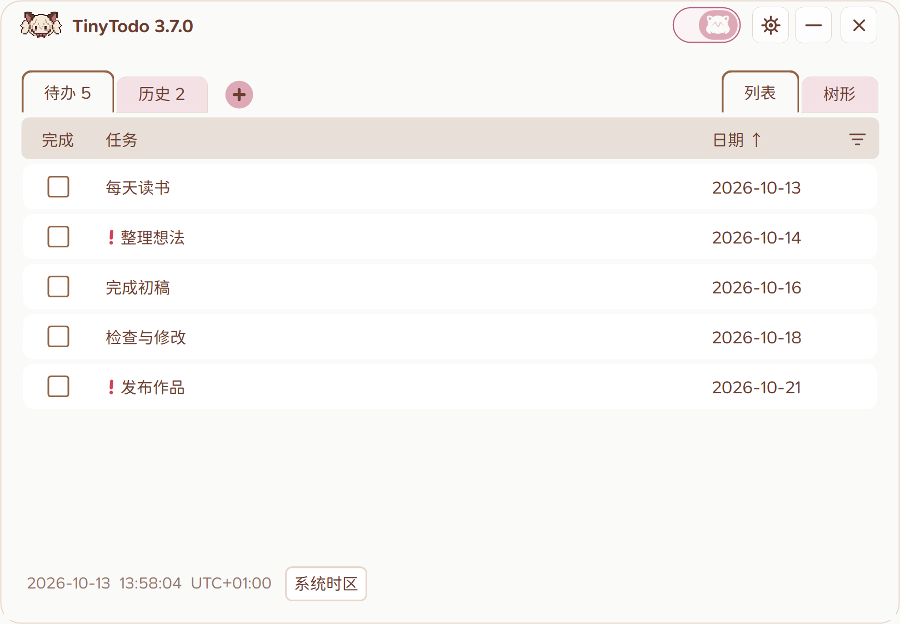
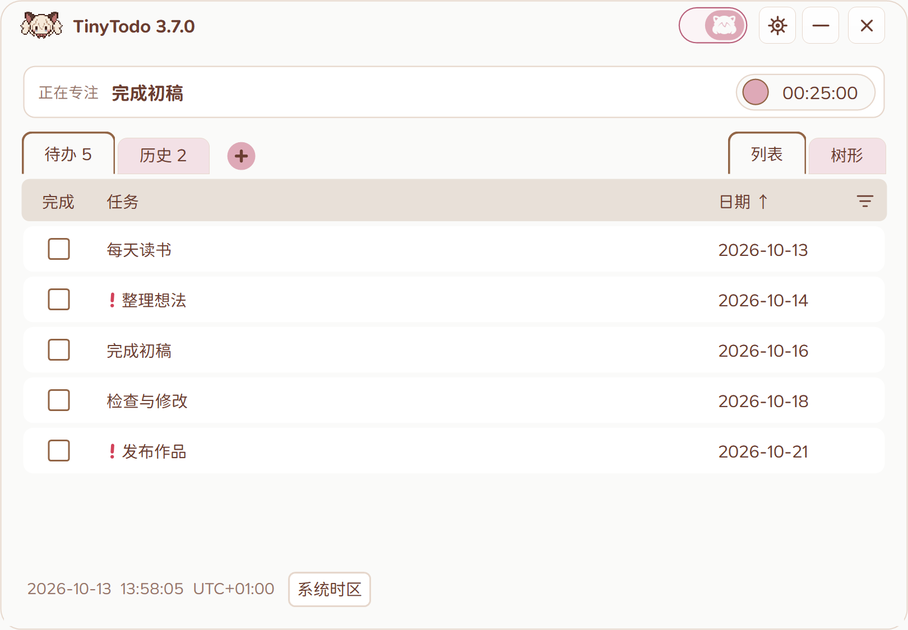
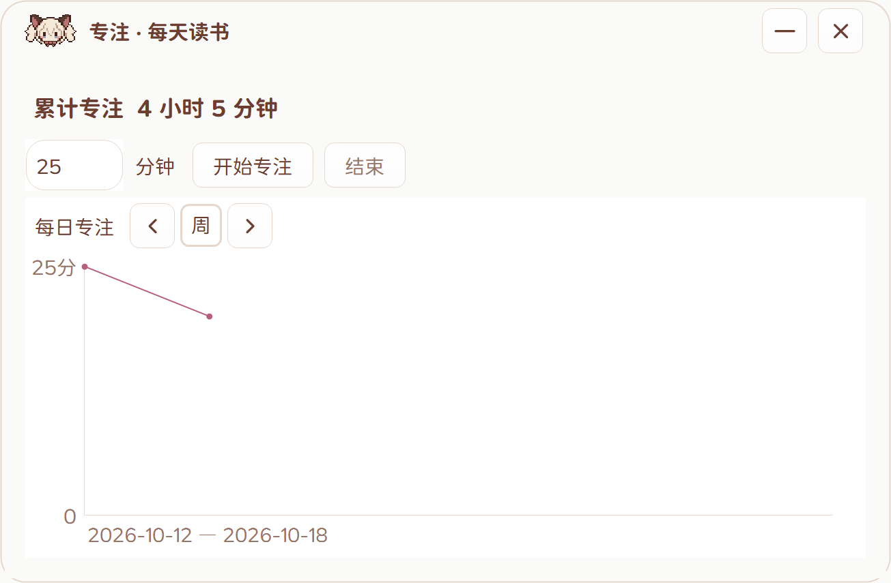
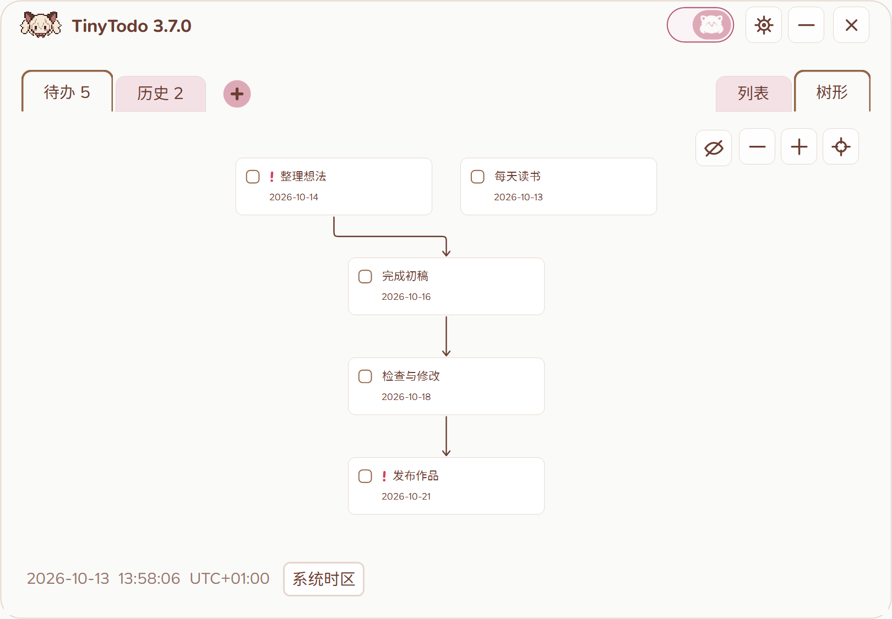
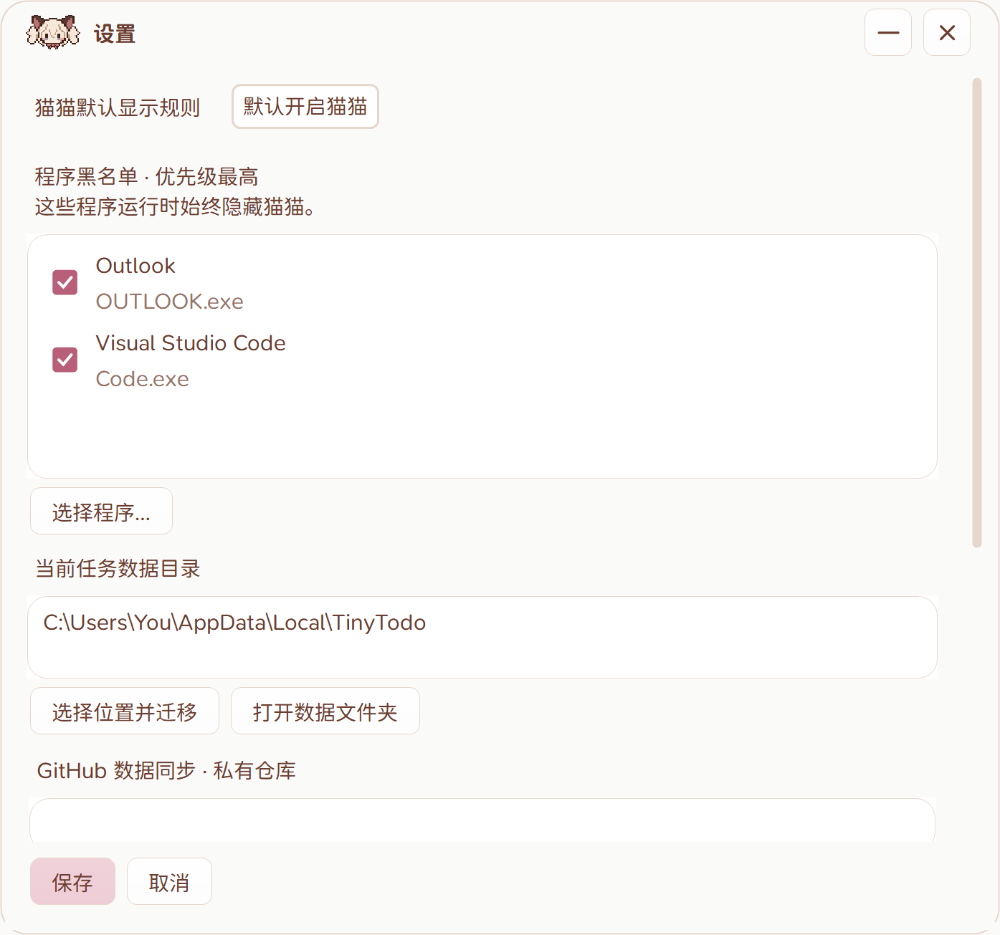
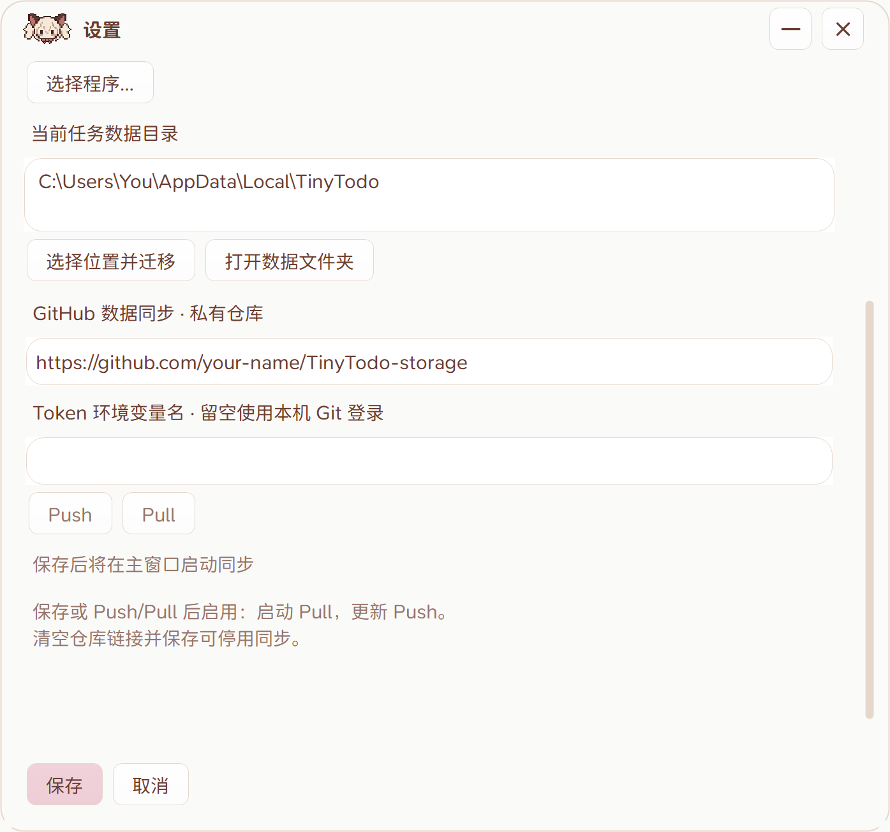

# TinyTodo

Windows 任务管理应用，支持任务依赖、循环任务、专注计时和 GitHub 私有仓库同步。

[下载安装包](https://github.com/zhuzihan728/TinyTodo/releases/latest) · [构建与测试](docs/BUILD.md)

运行安装包即可使用，默认勾选自启动和桌面快捷方式。升级直接覆盖安装，已有任务保留。

新建任务时可选择每天、每周或每月循环；完成后自动生成下一次，历史以 `xN` 显示完成次数。表头支持按日期、重要程度、名称和专注时间排序。

右键任务 → 专注，设定分钟数后开始，可暂停和继续。主页显示当前任务，猫猫上方显示胶囊倒计时；每日统计支持周、月、年，循环任务共享累计时间。

树状依赖关系、任务预览与 Markdown 描述。

猫猫开关与透明动态悬浮入口，支持同屏全屏隐藏和程序黑名单。

设置中填写 GitHub 私有仓库链接，启动自动 Pull，任务更新自动 Push，也可手动同步。Token 环境变量名留空时使用本机已有 Git 登录，详见[同步设置](docs/SYNC.md)。

macOS／Linux 应用见[待办](docs/ROADMAP.md)。

> Disclaimer：本项目全部使用 GPT 制作，图片也由 GPT 生成。
