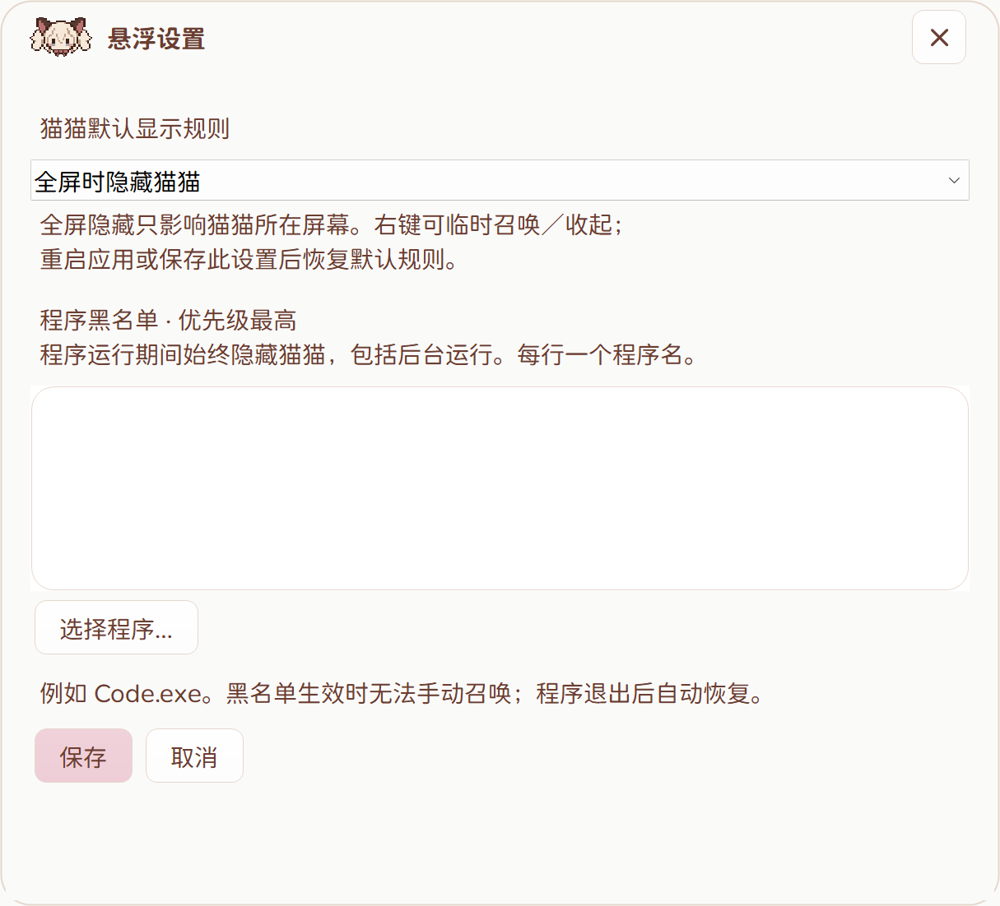

# 构建

Windows 10/11，.NET Framework 4.x。

- `build.cmd`：编译到 `bin/TinyTodo.exe`。
- `test.cmd`：业务测试。
- `ui-test.cmd`：界面测试；先退出 TinyTodo，测试使用临时数据。
- `powershell -ExecutionPolicy Bypass -File packaging/build-package.ps1 -Compiler "C:\Path\To\ISCC.exe"`：生成安装包与便携 ZIP。

安装包使用 [Inno Setup 6.7+](https://jrsoftware.org/isdl.php)。仓库不包含编译器；本地便携编译器可放在 `tools/InnoSetup`。

## 目录

- `src` / `tests`：源码与测试。
- `assets`：运行资源；`assets/source` 保留用户提供的原始素材。
- `packaging`：安装脚本和中文安装说明。
- `docs/screenshots`：演示数据截图。
- `dist`：本地生成的安装包和便携包，通过 GitHub Releases 分发。
- `artifacts` / `archive`：本地测试产物和历史归档，不提交。

安装器默认勾选开机自启动和桌面快捷方式，可取消。仅安装到当前用户目录，交互卸载默认勾选清理任务文件与备份，可取消保留数据。静默卸载默认保留数据；仅显式传入 `/PURGETASKDATA=1` 时清理。

字体许可证与来源见 `assets/Font-license.txt` 和 `assets/Font-source-notice.txt`。安装器中文翻译取自 [Inno Setup 翻译文件](https://github.com/jrsoftware/issrc/blob/main/Files/Languages/ChineseSimplified.isl)，保留文件内署名。

## 发布验证

2026-09-16：73 项业务测试、337 项 UI 检查通过（225% 缩放）；安装、取消卸载、默认勾选清理任务与静默卸载检查通过。`tools/TestInstaller.ps1` 在工作区临时目录验证安装包，不清理个人任务。

## 3.5.3 悬停修复

鼠标停留于原任务或 Markdown 预览卡片时保持预览；离开两者后短暂延迟关闭，原任务与卡片间切换不重建窗口。列表和树节点均使用实际命中范围；切换到其他应用仍关闭预览。升级请直接覆盖安装，安装器不写入任务数据目录。

验证：73 项业务测试、345 项 UI 检查通过；隔离执行 3.5.2 → 3.5.3 覆盖安装，默认自启动/桌面快捷方式与版本升级正常，已登记任务文件的 SHA256 前后一致，原安装登记未改变。可运行 `tools/TestUpgrade.ps1` 复现（需要旧版和新版发布目录及 Inno Setup）。

## 3.5.4 菜单图标

任务右键菜单的“设为／取消”复用任务预览按钮的红色叹号图标，紧跟文字、垂直居中，并忽略空快捷键栏的绘制请求。73 项业务测试、347 项 UI 检查通过；已隔离验证 3.5.3 → 3.5.4 覆盖升级，已登记任务文件哈希不变。

## 3.5.5 悬浮设置与窗口位置

设置 → 悬浮设置提供“默认隐藏猫猫 / 全屏时隐藏猫猫 / 默认开启猫猫”，默认选择同屏全屏隐藏。旧任务文件自动使用此默认值，任务结构和数据目录不变。

- 普通程序不再因系统通知“忙碌”状态隐藏猫猫。只比较前台全屏窗口与猫猫所在屏幕；普通最大化窗口不会误判。猫猫保留不激活窗口的置顶属性，主窗口和对话框遵循普通窗口层级。
- 主窗口每次重开保留上次位置，拖动猫猫不会改变主窗口位置。猫猫开关只控制猫猫显隐，任务表始终可从托盘打开。
- 托盘、猫猫右键和标题栏使用“收起猫猫 / 召唤猫猫”。手动选择持续到重启或保存悬浮设置；黑名单优先级更高。
- 黑名单每行一个程序名，也可选择 EXE。匹配程序名，不区分大小写；后台运行也生效。仅配置黑名单时在后台线程约每秒检测一次。黑名单生效时禁用召唤，保留其他托盘菜单功能；程序退出后自动恢复。

验证：93 项业务检查、379 项 UI 检查通过（225% 缩放），包含旧版悬停、托盘与输入隔离回归；新增位置保留、规则持久化、后台进程黑名单及退出恢复、无焦点置顶修复。多屏验证包含不同分辨率、负坐标的屏幕边界以及真实 Win32 无边框全屏窗口；未直接运行英雄联盟或 WoW。

Windows 行为参考：[SetWindowPos 的不激活选项](https://learn.microsoft.com/en-us/windows/win32/api/winuser/nf-winuser-setwindowpos)、[DWM 可见窗口边界](https://learn.microsoft.com/en-us/windows/win32/api/dwmapi/ne-dwmapi-dwmwindowattribute)。UI 测试会先点击其自身已验证的测试窗口，取得测试所需的前台权限；生产程序没有模拟输入、全局快捷键或键盘钩子。

最终安装包已隔离验证 3.5.4 → 3.5.5 覆盖升级；默认自启动与桌面快捷方式正常，已登记的 4 个数据文件 SHA256 完全一致，用户原安装登记未改动。

## 3.5.6 猫猫开关

主页使用胶囊开关，滑块沿轨道内缘等距移动，约 180 毫秒完成滑动与颜色过渡；快速切换从当前位置折返，隐藏或销毁控件时停止动画。右侧间距为原来的两倍。

- 开启：滑块与新增任务按钮共用 `Theme.AddAction`（`#DEA9B7`），图标使用主页背景色 `#FAFAF9`。
- 关闭：米灰色滑块与棕色图标；黑名单生效时禁用。
- 使用用户最终确认的 PNG，原图保存在 `assets/source/cat-toggle-original.png`，运行资源为 `assets/cat-toggle.png`。仅图标排版忽略透明导出噪点，不改写原图。

`tools/CaptureDocs.cs` 使用独立演示数据生成列表、树视图与开关截图。最终版本通过 93 项业务检查和 379 项 UI 检查（225% 缩放），包含任务编辑、完成反馈、Markdown 悬停、托盘、悬浮设置、黑名单、窗口恢复和输入隔离。悬停测试固定窗口在屏幕内，避免系统级联放置影响鼠标命中。

根目录的草稿图和旧版构建移入本地忽略目录 `archive/pre-3.5.6`，不进入发布包；最终素材、源码、验证脚本与截图保留在仓库。

最终安装包已隔离验证 3.5.5 → 3.5.6 覆盖升级；默认自启动及桌面快捷方式正常，已登记的 4 个任务／配置文件 SHA256 完全一致，原安装登记未改变。便携包的程序、最终图标、字体与许可证均已校验。

## 3.5.7 窗口交互、预览与统一设置

- 主窗口、任务预览、编辑和设置保持置顶；同屏前台全屏应用出现时直接收起，离开全屏后原位恢复，不抢回其他软件的焦点。其他屏幕不受影响。
- 编辑和设置使用独立窗口，主页面仍可操作。会冲突的操作被拦截并闪两次边框；其他任务可继续编辑，未保存草稿不被刷新覆盖。
- 任务预览操作栏固定在顶部，正文、长标题和前后置列表整页滚动。树形按实际可见画布居中并选择合适缩放；普通滚轮滚动页面，左键加滚轮缩放树形。归位会恢复合适缩放和当前任务位置。
- 设置集中在首页，保存／取消固定在底部。自定义显示规则选择器与标签同排；黑名单通过程序选择器添加、取消勾选移除，并有反馈动画。程序列表按需读取开始菜单、已安装登记、运行程序和 Store 应用，支持搜索；未登记程序仍可浏览 EXE 添加。
- 各类页面在本次运行中分别记住拖拽后的窗口大小，重启应用恢复默认。只移动或最小化窗口不会覆盖大小记忆。
- Markdown 悬停等待 750 毫秒，快速经过不弹出。点击任务选中边框；同项保持选中，其他任务转移选中，点击其他应用内区域取消。临时弹层关闭后返回其所属页面，切换到外部软件不抢焦点。
- 托盘和猫猫菜单使用“设置”入口，移除“完成历史”。数据目录操作仍在设置中。程序不注册全局快捷键或键盘钩子。

构建和测试记录位于本地忽略目录 `artifacts/release-3.5.7/`。业务数据验证为 93 项，UI 回归为 551 项（225% 缩放），包含真实鼠标点击、窗口调整、完整滚动条端点、输入法组合键、独立进程全屏收起与恢复。未直接运行英雄联盟或 WoW，跨屏规则另用不同分辨率及负坐标边界验证。

`tools/TestUpgrade.ps1` 在本版发布时验证 3.5.6 → 3.5.7 覆盖安装，使用独立安装登记和快捷方式目录，并核对已有任务文件哈希。`tools/TestInstaller.ps1` 使用独立安装登记检查卸载清理选项、取消及静默卸载，不替换用户真实安装。

程序发现专项：设置 `TINYTODO_PROGRAMS_ONLY=1` 后运行 UI 测试。窗口与安装行为参考：[不激活显示的 ShowWindow](https://learn.microsoft.com/en-us/windows/win32/api/winuser/nf-winuser-showwindow)、[应用登记](https://learn.microsoft.com/en-us/windows/win32/shell/app-registration)、[当前用户应用包查询](https://learn.microsoft.com/en-us/powershell/module/appx/get-appxpackage)。

3.5.7 最终发布验证：93 项业务检查、551 项 UI 检查通过；3.5.6 → 3.5.7 隔离覆盖升级通过，自启动和桌面快捷方式默认勾选。4 个已登记数据文件 SHA256 前后一致，用户真实安装登记未改变。独立卸载验证确认清理选项默认勾选、取消不移除文件、静默卸载保留任务及无关文件。便携包 14 个文件与发布目录逐一匹配，EXE／安装器版本均为 3.5.7.0，发布 SHA256 清单核对通过。

旧构建、草稿脚本和本地调试产物归档到忽略目录 `archive/pre-3.5.7/`；`dist/` 保留当前发布包，`artifacts/release-3.5.7/` 保留本次验证记录。

## 3.5.8 黑名单提示

精简设置中的黑名单说明为“这些程序运行时始终隐藏猫猫。”，同步更新演示截图。

本次重新编译和打包通过，隔离验证 3.5.7 → 3.5.8 覆盖升级通过；自启动和桌面快捷方式默认勾选，4 个已登记任务／配置文件 SHA256 前后一致，用户真实安装登记未改变。便携包 14 个文件与发布目录逐一匹配，程序及安装器版本均为 3.5.8.0，SHA256 清单核对通过。本次为文案调整，未重复运行完整业务与 UI 测试；完整回归结果见 3.5.7。

`tools/TestUpgrade.ps1` 在本版发布时验证 3.5.7 → 3.5.8。当前验证记录位于本地忽略目录 `artifacts/release-3.5.8/`，旧发布产物归档到 `archive/pre-3.5.8/`。

## 3.5.9 桌面菜单与窗口恢复

- 猫猫与托盘共用菜单在打开时仅激活菜单，不激活猫猫或主窗口。点击其他软件或按 Esc 可关闭菜单；同一次外部点击仍送达目标软件。托盘菜单继续等右键释放处理结束后再打开，避免一闪而过。
- 右键“添加任务”在菜单关闭后直接打开独立编辑窗，主页显隐、位置、历史／待办与列表／树形保持不变。重复点击恢复已有草稿，取消草稿不改变任务数据。
- 猫猫、托盘与“展开任务表”只恢复窗口，不再重置历史／待办、视图或树形缩放与位置。

最终验证：93 项业务检查、673 项 UI 检查通过（225% 缩放）。包括真实鼠标点击、窗口焦点与位置、编辑冲突、任务完成／恢复反馈、长标题、固定操作栏、滚动端点、树形缩放、Markdown 悬停、输入隔离、同屏全屏收起与恢复。程序选择器专项通过，识别 235 个应用，其中 32 个来自 Microsoft Store；搜索、添加、取消勾选反馈与关闭窗口联动正常。已人工查看长标题、树形画布、设置底部及程序选择器截图。游戏兼容验证使用独立进程全屏测试窗口；未直接运行英雄联盟或 WoW，跨屏规则使用不同分辨率及负坐标边界验证。

3.5.8 → 3.5.9 隔离覆盖升级通过，自启动与桌面快捷方式默认勾选；3 个已登记任务／配置文件 SHA256 前后一致，用户真实安装登记未改变。独立卸载验证确认清理选项默认勾选、取消保留程序文件、静默卸载保留无关文件。便携包 14 个文件与发布目录匹配，程序／安装器版本为 3.5.9.0，SHA256 清单核对通过。

`tools/TestUpgrade.ps1` 在本版发布时验证 3.5.8 → 3.5.9。验证日志及界面截图保存在本地忽略目录 `artifacts/release-3.5.9/`；旧构建与调试产物归档到 `archive/pre-3.5.9/`。README 仅使用独立演示数据截图。

## 3.6.0 循环与专注

- 每天、每周指定星期、每月指定日期。短月份按月末处理；逾期完成仅生成下一次未来任务。完成／恢复不会重复生成同一日期的循环任务。历史按系列归组，`xN` 是当前完成记录数；删除或恢复一条完成记录会相应减少次数。
- 移除状态列，表头排序菜单支持日期、重要程度、创建时间、名称、累计专注时间及反向排序。筛选按钮采用无外框细线图标，隐藏窗口初始化时也预留滚动条宽度。
- 专注记录按循环系列共享；暂停不计时，达到设定时长自动结束并发出托盘通知。每 15 秒保存一次，结束、暂停或正常退出时保存余下时间。异常退出最多丢失尚未保存的 15 秒；重启不自动继续计时。每日统计按系统本地日期分段。
- 悬停预览按弹出时的鼠标位置定位，边缘处调整方向，移入缓冲为 550 毫秒；长标题按实际行数排版。循环选择、专注操作与图表导航按中线对齐，纵轴文字统一右对齐。
- 新数据使用版本 2，读取旧版本 1 后在下次保存时升级。旧程序会拒绝版本 2，避免覆盖新增字段。

2026-10-13 发布验证：120 项业务检查、697 项完整 UI 检查通过（225% 缩放）；另通过 100% 与 225% 布局专项。覆盖月末与闰年、完成重试、历史归组、跨午夜计时、暂停／继续、写入失败、共享累计时间，以及菜单、窗口、滚动、预览和输入隔离行为。

3.5.9 → 3.6.0 隔离覆盖升级通过；自启动和桌面快捷方式默认勾选，4 个已登记任务／配置文件 SHA256 前后一致，原安装登记未改变。真实任务的独立副本完成格式迁移、保存和重开，任务字段、依赖、设置与已有专注记录均保留。卸载清理选项默认勾选，取消卸载保留程序，静默卸载保留数据和无关文件。便携包 14 个文件与发布目录一致，程序／安装器版本均为 3.6.0.0，SHA256 清单核对通过。

验证日志保存在本地忽略目录 `artifacts/release-3.6.0/`；旧发布包归档到 `archive/pre-3.6.0/`。README 截图使用独立演示数据。

试用入口：`powershell -ExecutionPolicy Bypass -File tools/Preview.ps1`。它使用 `artifacts/productivity/trial/` 中的独立任务副本；已安装应用仍读取原数据目录。

macOS／Linux 桌面支持暂缓，见 [ROADMAP.md](ROADMAP.md)。

## GitHub 同步开发验证

2026-10-13 本地验证：120 项业务检查、39 项同步检查、722 项 UI 检查通过（225% 缩放）。覆盖启动 Pull、保存后 Push、手动同步、冲突确认、断网保留数据、编辑窗口保护、传输中继续编辑及退出前上传。

私有仓库完成真实上传、下载、并发合并与过期 SHA 拒绝测试，临时测试分支已清理。独立试用副本通过留空环境变量名复用 Git 登录，云端任务与专注记录匹配，本机设置未上传，已安装应用的任务文件哈希保持一致。验证日志位于忽略目录 `artifacts/sync/`。本次未打包发布；配置方式见 [SYNC.md](SYNC.md)。

## 专注倒计时界面

猫猫上方显示胶囊倒计时，圆形进度表示剩余时间。主页在专注期间显示任务名与同款倒计时，点击可打开当前任务的专注窗口；暂停保留读数，结束后收起。所有专注倒计时统一为 `HH:mm:ss`，最长 24 小时。长任务名省略显示，悬停可读完整名称。

2026-10-13 本地验证：120 项业务、39 项同步、731 项 UI 检查通过（225% 缩放）。检查了暂停／继续、长标题与最小窗口、历史页显示、点击恢复专注窗口、猫猫拖动及屏幕边缘位置。截图与日志位于忽略目录 `artifacts/countdown/`；本次未打包发布。

## 3.7.0 发布验证

包含 GitHub 私有仓库同步、主页当前专注任务与猫猫胶囊倒计时。120 项业务、39 项同步、731 项 UI 检查通过；私有仓库真实 Push/Pull、并发合并与过期 SHA 保护通过。

3.6.0 → 3.7.0 隔离覆盖升级通过，自启动和桌面快捷方式默认勾选；4 个已登记任务／配置文件 SHA256 前后一致，原安装登记未改变。卸载清理选项默认勾选，取消保留程序，静默卸载保留数据及无关文件。安装器与程序版本为 3.7.0.0，便携包 14 个文件逐一匹配，SHA256 清单核对通过。

发布验证记录位于 `artifacts/release-3.7.0/`，旧发布包及临时构建归档到 `archive/pre-3.7.0/`。README 截图仅使用独立演示数据。
